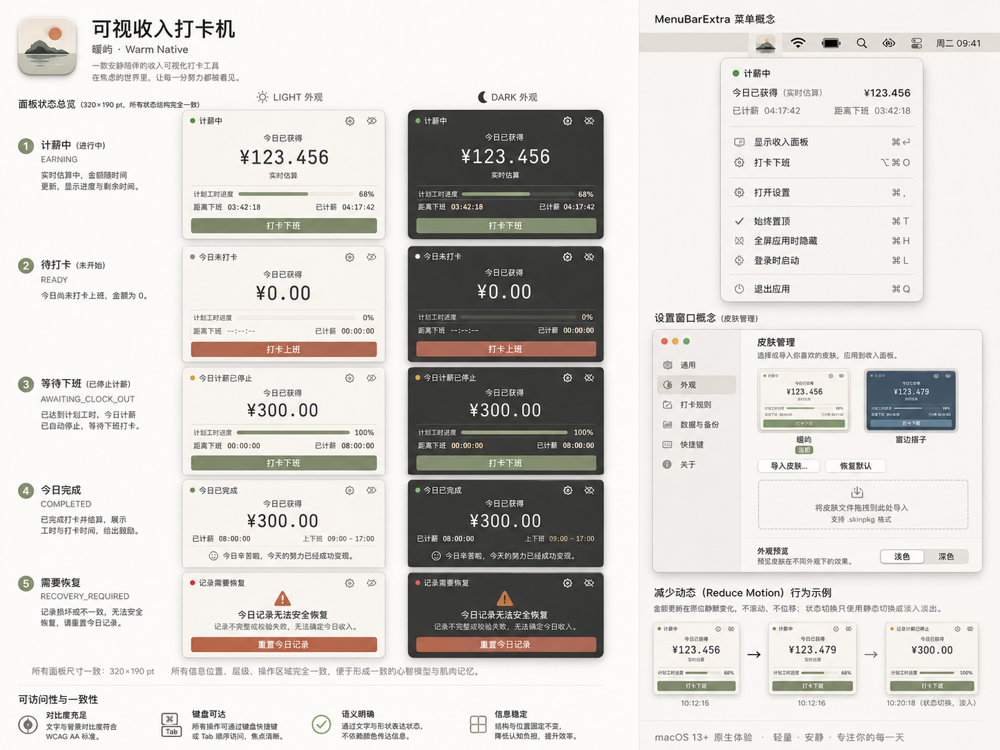

# 可视收入打卡机

一款 macOS 原生菜单栏工具，把今天的工作时间变成看得见的收入进度。

设置日工资和班次 → 上班打卡 → 查看今日收入与剩余时间 → 下班结算。

> 当前是开发中的源码项目，用于备份、开发和展示。尚无经过完整验收的 RC 或正式安装包；上传源码不表示应用已完成发布验收。

## 已实现的功能

- **当天计薪**：设置日工资、上下班时间，手动打卡；按有效工作时长计算收入，到固定下班时间停止计薪，提前下班需确认预计金额。
- **菜单栏与悬浮面板**：查看当前状态、今日金额和剩余时间；支持显示／隐藏、置顶、锁定位置、全屏应用时隐藏及恢复默认位置。
- **两套内置皮肤**：「暖屿」「窗边搭子」，支持跟随系统、浅色和深色外观。
- **皮肤管理**：导入 `.incomeclocktheme`，校验、预览、安装／更新、切换与删除；皮肤提示音默认关闭。
- **本地保存**：保存工资设置、今日记录和皮肤偏好；退出后可恢复当天状态，记录损坏时提供恢复／重置入口。
- **应用菜单快捷键**：`⌥⌘I` 显示／隐藏面板、`⌘,` 打开设置、`⌘Q` 退出。它们不是已验证的系统全局热键。

金额依据设备时钟和冻结的工作日快照重新计算，不按动画帧累加；当天已打卡记录沿用冻结的时区与班次，之后修改工资或工作时间对下一自然日生效。目前只维护当天状态，开始新一天会清除上一工作日结算，未实现周／月统计和历史账本。

<details>
<summary>查看内置皮肤的设计参考</summary>

下图来自现有「暖屿」皮肤资源，是设计参考，不是当前原生运行或验收截图；图中文字、快捷键和导入格式可能与当前实现不同，以本文和源码为准。



[查看「窗边搭子」设计参考](IncomeClock/Resources/BuiltinThemes/app.incomeclock.window-companion/preview.png)

</details>

## 环境与依赖

- macOS **13.0 及以上**，Swift / SwiftUI / AppKit。
- Xcode 与 macOS SDK；工程的 Swift language version 为 5.0，尚未声明经过验证的最低 Xcode 版本。
- Swift Package Manager 依赖 **ZIPFoundation 0.9.20**，锁定 revision `22787ffb59de99e5dc1fbfe80b19c97a904ad48d`。首次解析需获取依赖，许可见 [第三方声明](IncomeClock/Resources/THIRD_PARTY_NOTICES.txt)。

## 获取、构建与隔离运行

```bash
git clone https://github.com/qife422/income-clock.git 可视收入打卡机
cd 可视收入打卡机
open IncomeClock.xcodeproj
```

项目包含 `IncomeClock` scheme。以下是开发命令示例，**本次文档整理未执行构建或启动**；仓库维护者继续开发时，应先遵循 [项目入口](AGENTS.md) 和 [当前状态](DEVELOPMENT_STATE.md) 的授权、容量与隔离门禁。

源码构建示例将缓存和结果放在工作树之外，不生成正式签名发行物：

```bash
BUILD_ROOT="$(mktemp -d /private/tmp/IncomeClockBuild.XXXXXX)"
xcodebuild -project IncomeClock.xcodeproj \
  -scheme IncomeClock -configuration Debug -destination 'platform=macOS' \
  -derivedDataPath "$BUILD_ROOT/DerivedData" \
  -clonedSourcePackagesDirPath "$BUILD_ROOT/SourcePackages" \
  -resultBundlePath "$BUILD_ROOT/Build.xcresult" \
  build CODE_SIGNING_ALLOWED=NO
```

运行开发构建时，显式指定新的隔离数据目录，避免进入真实 Application Support：

```bash
DATA_ROOT="$(mktemp -d /private/tmp/IncomeClockData.XXXXXX)"
INCOMECLOCK_TEST_ROOT="$DATA_ROOT" \
  "$BUILD_ROOT/DerivedData/Build/Products/Debug/IncomeClock.app/Contents/MacOS/IncomeClock"
```

保留 `DATA_ROOT` 路径，后续用同一目录重启才能观察当天状态恢复。这里的临时目录随系统清理可能丢失，不适合作长期备份。若本机沙盒、签名或系统策略阻止启动，按活动门禁诊断，不自行改权限或签名。不要通过直接双击开发构建来验证真实数据。

Debug 使用模拟通知和模拟登录项服务；真实系统服务仅接在非 Debug 分支。本地演示不能证明系统通知、登录启动或原生 UI 已通过验收；通知展示还受权限、专注模式及 macOS 调度影响。

## 项目结构

```text
IncomeClock/
  App/                 应用入口与环境装配
  Domain/              时间、工作日状态与计薪规则
  Application/         业务状态、皮肤与系统服务协调
  Infrastructure/      本地持久化、皮肤校验、通知与登录项
  Presentation/        菜单栏、悬浮面板和设置
  Resources/           内置皮肤、图像和第三方声明
IncomeClock.xcodeproj/  Xcode 工程与依赖锁定
IncomeClock*Tests/      Domain、Persistence、Application 与 UI 测试
scripts/               阶段验证工具，按当前授权运行
```

部分历史测试和验证脚本依赖原工作机的临时 fixture 或固定证据，单独 clone 不保证完整测试立即可运行。验证入口与未完成项见 [收尾记录](STAGE9_CLOSEOUT.md)；不要把缺失的历史目录当成已恢复的测试现场。

## 防丢与恢复

GitHub 用来保存已提交并成功推送的源码、工程、资源和文档。**真实工资、打卡记录、应用偏好、临时 DerivedData、`.xcresult` 及完整历史验证现场不属于源码备份。** 本地未提交或未推送的修改也无法通过远端找回。

- **恢复开发项目**：重新 clone，恢复锁定的依赖，阅读 `DEVELOPMENT_STATE.md`，再按当前范围重新构建；不要恢复旧缓存来冒充当前构建。
- **恢复个人数据**：数据位于本机应用容器的 Application Support；业务根目录由系统 Application Support 路径加 `com.ffq.incomeclock` 组成，包含 `Records/settings.json`、`today.json`、`theme-preferences.json` 等。皮肤、面板偏好和其他相关设置也需独立备份。先退出应用，另存到私有备份；勿把工资、记录或个人备份提交到公开仓库，也不要直接覆盖唯一原件。当前未提供一键云备份／导出恢复流程。
- **恢复验证证据**：clone 不能恢复工作机临时路径或未上传的证据。保留的治理／Spec 文档含本机历史路径，仅用于追溯，不代表克隆后证据可用，也不自动继承历史 PASS。

当前已知缺少 `Resume008BoundedFixtures`、`Resume008SchemaFixtures` 两组临时夹具，以及 7 个固定音频归档（合计约 20.5 MiB）。虽然代码中有生成器，尚未验证能按原 SHA 重建这些输入；相关历史 integration／native 测试不能直接复跑。本次未构建或测试，源码备份不冒充完整验证现场保全。

许可范围：ZIPFoundation 沿用其 [第三方许可声明](IncomeClock/Resources/THIRD_PARTY_NOTICES.txt)，内置皮肤保留各自目录中的 `LICENSE.txt`。项目整体暂未指定统一开源许可。

## 当前限制

截至 [当前状态 §159](DEVELOPMENT_STATE.md)：Stage 9 总体结论仍为 **NOT_READY**，最终用户接受为 **PENDING**。最近一次 Runner 权限恢复和静态身份检查已完成，但闭菜单相关原生行为仍 **UNVERIFIED**；旧运行 profile 不能直接复用，后续原生验证需要新授权。源码备份／分享不改变正式二进制发布、公证和部署门禁。

## 后续更新

已有本地修改时先检查并保存，再更新：

```bash
git status
git pull --ff-only
```

维护时每个可验证改动形成一次清楚的提交，在 [CHANGELOG.md](CHANGELOG.md) 记录新增、修复、实际验证和剩余限制，随后推送到远端。**新增顶层文件或目录时，检查 `.gitignore` 的上传白名单**，确认应备份的内容会被跟踪，且不会带入历史生成物。遇到分叉或冲突先处理具体差异，不使用强制重置覆盖本地工作。分享源码可直接发送仓库页面；只有满足验收与发行门禁后才建立对应的正式发行记录。
